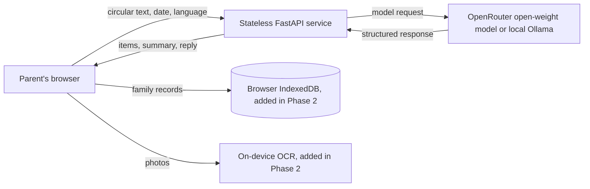

# Circular Sloth

One tap in WhatsApp, then zero effort. Circular Sloth turns school circulars into a short, reviewable list of what a parent needs to do. The parent approves suggested items before using them.

## Why open-weight
Circulars can include a child's class and school. Open-weight models can be run locally or through a provider that hosts open-weight models, and the provider can be changed without tying family records to one model company. Photos are intended to stay on the device; only extracted text is sent when using hosted mode.

## Ownership guarantees
Every family's records belong in that family's browser profile. The server has no database, accounts, sessions, cookies, or request-data storage. It logs only response status and latency. Images are processed on-device and discarded. In hosted mode, extracted text (never photos) is sent momentarily to the configured third-party provider, such as OpenRouter and the company hosting the model; the server does not store that text, and the provider's own policies apply. Never send a child's name to the model; class labels are matched on-device.

Two people sharing the same browser profile share its data. The optional PIN is meant to deter casual snooping, not to encrypt the browser's live data. Use the encrypted backup to move or protect a copy of family records. This initial backend phase does not yet include the browser workspace or backup UI.

## Architecture



The API uses FastAPI and Pydantic, with OpenAI-compatible and Ollama adapters. Each service instance limits model calls to two concurrent requests and keeps an in-memory per-IP request limit. It has no persistent disk, database, or request-body logging.

## Setup

### A. Fully local with Ollama

Ollama and `gemma3:4b` are installed locally. To verify fully offline, disconnect the network after the model is available and run the API and smoke script using the process settings below:

```powershell
ollama pull gemma3:4b
ollama serve
```

In a second PowerShell window, configure the process for the local run and start the API:

```powershell
$env:LLM_PROVIDER = 'ollama'
$env:BASE_URL = 'http://localhost:11434'
$env:MODEL_NAME = 'gemma3:4b'
.\.venv\Scripts\python.exe -m uvicorn app.main:app --host 127.0.0.1 --port 8000 --no-access-log
```

Keep `ollama serve` running. The app makes model calls to the local Ollama endpoint. After the model is pulled, reading can work without internet. Verify with:

```powershell
.\.venv\Scripts\python.exe scripts/smoke_live.py http://127.0.0.1:8000
```

### B. Hosted on Render with OpenRouter

1. Push the repo to GitHub, then create a Render Blueprint from the repository and apply `render.yaml`.
2. In the Render service's Environment page, set `API_KEY` by typing your OpenRouter key directly into the dashboard. Do not paste it into a repo file or chat.
3. The Blueprint defaults are `LLM_PROVIDER=openai_compat`, `BASE_URL=https://openrouter.ai/api/v1`, and `MODEL_NAME=google/gemma-4-26b-a4b-it:free`.
4. Wait for deployment and verify the service with `python scripts/smoke_live.py https://YOUR-SERVICE.onrender.com`.

Free models may be busy. To switch to the paid version of the same model, remove `:free` from `MODEL_NAME` in Render. Provider pricing and availability can change.

### C. Self-hosted model

Set `LLM_PROVIDER=ollama`, `BASE_URL` to the Ollama server's reachable URL, and `MODEL_NAME` to a locally available open-weight model. For an OpenAI-compatible vLLM endpoint, use `LLM_PROVIDER=openai_compat`, a `BASE_URL` ending in `/v1`, the open-weight model name, and its API key if required. Keep the model endpoint on infrastructure you control.

For local Docker, `docker compose up --build` starts the app using `.env`. To start the optional Ollama container, first run `docker compose --profile offline up -d ollama`, pull the model with `docker compose exec ollama ollama pull gemma3:4b`, and configure the app to use `BASE_URL=http://ollama:11434`, `LLM_PROVIDER=ollama`, and `MODEL_NAME=gemma3:4b`.

## API and limits

- `GET /api/health` checks the configured model and caches the result for 30 seconds.
- `POST /api/read` accepts up to 30 chunks and 24,000 total text characters by default.
- `POST /api/summary` returns three short lines.
- `POST /api/reply` drafts a short polite message. Optional child and teacher labels are intentionally omitted from the model request.
- 429/5xx model responses retry with increasing waits and honor `Retry-After`; an optional `FALLBACK_MODEL_NAME` is tried after primary failures.
- Request size, timeout and per-IP hourly limit can be configured with `MAX_CHARS`, `REQUEST_TIMEOUT_S` and `RATE_LIMIT_PER_HOUR`.

## Results

| Check | Result |
|---|---|
| Backend tests | 12 passed (Phase 1) |
| Local Docker build | Passed (Phase 1) |
| OpenRouter localhost smoke test | Ran against `.env`; free-tier calls were busy after 5 retries or returned malformed JSON, so the injected-value check did not pass |
| Local-only Ollama `gemma3:4b` smoke test | Passed; returned injected Rs 730 and 2026-12-29 from localhost Ollama. The app made no hosted-provider call; the computer's internet connection itself was not disabled |
| Synthetic extraction evaluation | Planned for Phase 4 |
| OCR text accuracy | Planned for Phase 4 |

## Limitations
Models and OCR can misread a notice, so the parent must review extracted items. Hosted free-tier models can be busy. The phone app, OCR pipeline, local encrypted backup, calendar reminders, and cross-device sync are not part of the current backend phase. Calendar reminders will rely on the user's calendar app. No iPhone share target is promised.

## Roadmap
- Build the offline-first browser workspace, encrypted backup and local PIN in Phase 2.
- Add circular input, local OCR, review, the weekly fridge slip, calendar export, summary and reply in Phase 3.
- Evaluate English, Hindi, Marathi and Hinglish notices; polish the design and accessibility in Phase 4.
- Explore fine-tuning on Hinglish and Marathi school notices with Tinker, and local voice notes with Whisper.
