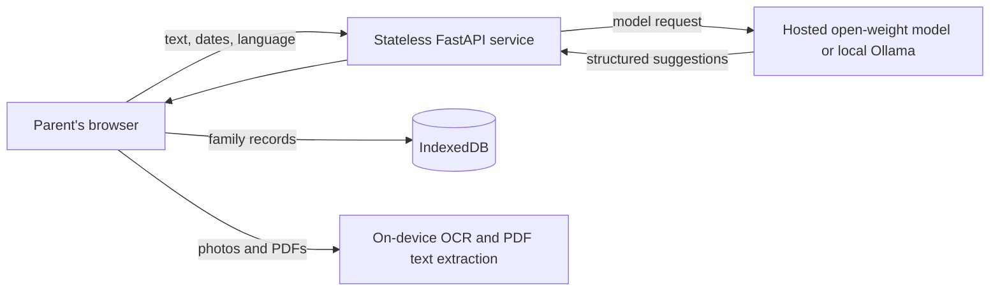

# Circular Sloth

Circular Sloth turns school circulars into a short, reviewable list of what a parent needs to do. Add a pasted message, photo, PDF, or shared item; extract text; review and edit suggestions; then save the items to the browser's local workspace. It also includes a weekly fridge slip, calendar export, summary, and reply drafting.

The project uses open-weight language models through OpenRouter or a compatible hosted endpoint, and can use Ollama locally. A model can make mistakes: parents must check every extracted item before saving or acting on it.

## Privacy and ownership

- Family records are stored in IndexedDB in the browser profile. The server has no accounts, database, cookies, or family-record storage.
- Photos and PDFs are processed in the browser; the app sends extracted text to the API when model assistance is requested. In hosted mode that text is sent to the configured model provider. The provider's retention and privacy policies apply.
- Child and teacher names are not included in the model's reply-drafting request. Class matching happens on-device.
- The optional PIN deters casual access; it does not encrypt the browser's live workspace. Encrypted export is available for backups. A plaintext CSV export is also available and should be handled carefully.
- People using the same browser profile share its workspace. There is no cross-device synchronization.

## Architecture



The API uses FastAPI and Pydantic with OpenAI-compatible and Ollama adapters. Each instance limits model calls to two concurrent requests and applies an in-memory per-IP request limit. Request bodies and extracted text are not logged. The frontend is React, TypeScript, and Vite; IndexedDB uses Dexie, OCR uses Tesseract.js, and PDFs use PDF.js.

## Development

Requirements: Python 3.11+, Node.js 22+, and (for the offline model) Ollama with `gemma3:4b` pulled. Copy `.env.example` to `.env` and set `API_KEY` for hosted development. Never commit `.env`.

```powershell
python -m venv .venv
.\.venv\Scripts\Activate.ps1
pip install -r requirements.txt
cd web
npm ci
npm run build
npm test
cd ..
python -m pytest
```

Start the API with `python -m uvicorn app.main:app --host 127.0.0.1 --port 8000 --no-access-log`. Start the web app in another terminal with `cd web; npm run dev`; Vite proxies API requests to localhost.

### Offline Ollama check

Pull the model before going offline, then start Ollama and the API. The app's API requests must use Ollama directly. Disconnecting internet is the strongest way to prove no hosted call is possible.

```powershell
ollama pull gemma3:4b
$env:LLM_PROVIDER = 'ollama'
$env:BASE_URL = 'http://localhost:11434'
$env:MODEL_NAME = 'gemma3:4b'
python -m uvicorn app.main:app --host 127.0.0.1 --port 8000 --no-access-log
```

Then run `python scripts/smoke_live.py http://127.0.0.1:8000`. The documented local smoke result was successful; internet disconnection was not performed during that run, so it verifies the Ollama path rather than a fully isolated network.

### Docker

The Dockerfile builds the Vite frontend and serves it through the FastAPI app. With `.env` configured, run `docker compose up --build`. For local Ollama in Compose, start the optional service with `docker compose --profile offline up -d ollama`, pull the model using `docker compose exec ollama ollama pull gemma3:4b`, and set the app's `LLM_PROVIDER=ollama`, `BASE_URL=http://ollama:11434`, and `MODEL_NAME=gemma3:4b`.

### Hosted Render deployment

The repository includes `render.yaml`. Create a Render Blueprint from the GitHub repository, then set `API_KEY` in the service's Environment dashboard. The configured hosted provider uses `LLM_PROVIDER=openai_compat`, `BASE_URL=https://openrouter.ai/api/v1`, and `MODEL_NAME=google/gemma-4-26b-a4b-it:free`. Never put the API key in source control or a client-side variable. Verify a deployment with `python scripts/smoke_live.py https://YOUR-SERVICE.onrender.com`.

Free model capacity can be unavailable or rate-limited. Removing `:free` selects the paid model variant and may incur charges. Availability and pricing change over time.

### Other self-hosted providers

For Ollama, use `LLM_PROVIDER=ollama`, a reachable `BASE_URL`, and a model already pulled on that host. For a vLLM or other OpenAI-compatible endpoint, use `LLM_PROVIDER=openai_compat`, its `/v1` base URL, model name, and key if required. Keep endpoints on infrastructure you control if you need to control text retention.

## API

- `GET /api/health` checks the configured model and caches the result for 30 seconds.
- `POST /api/read` accepts up to 30 chunks and 24,000 total text characters by default.
- `POST /api/summary` returns three short lines.
- `POST /api/reply` drafts a short polite message without sending child or teacher labels to the model.
- 429/5xx responses retry with increasing waits and honor `Retry-After`; `FALLBACK_MODEL_NAME` optionally supplies a fallback.
- `MAX_CHARS`, `REQUEST_TIMEOUT_S`, and `RATE_LIMIT_PER_HOUR` configure request size, timeout, and the per-instance hourly limit.

## Verification results

| Check | Result |
|---|---|
| Backend tests | 12 passed |
| Frontend tests | 7 passed |
| TypeScript and production frontend build | Passed |
| OpenRouter localhost smoke | Health reported the provider as busy; the read call then failed with a remote connection reset. The injected-value check did not pass |
| Ollama localhost smoke | Passed with `gemma3:4b`; returned injected Rs 756 and 2027-02-16 exactly once. The machine stayed online; all model requests went to localhost Ollama |
| Render live health and smoke | Health was ready; smoke passed with injected Rs 285 and 2027-05-01 exactly once |
| Docker image build | Not completed: Docker Desktop's Linux engine returned an internal API error during startup |
| Multilingual extraction evaluation | On 30 synthetic notices, configured free OpenRouter model yielded 1/31 expected items (3%), 0 extra items, 100% date accuracy on the one matched item, 0% amount accuracy, 100% audience accuracy on that one match, median latency 19.5s, and 29 provider errors |
| OCR text accuracy | 99.4% character accuracy (178/179); 4/5 exact snippets on five locally rendered synthetic English, Hindi, and Marathi samples. Rendering used the Windows Mangal font |

To reproduce the small Windows OCR check, run `./eval/ocr_check.ps1`. The script renders only the synthetic examples in `eval/ocr_samples.json`, runs the same locally bundled Tesseract.js language data, prints the recognized text and character accuracy, and removes its temporary images.

Synthetic evaluation data contains no real children's or school records. The low extraction score is not a meaningful model-quality estimate because 29 requests failed at the provider; it shows the free endpoint was unreliable during this run. Results are not a guarantee of accuracy on real notices.

## Limitations and next steps

Extraction and OCR can misread a notice. Always review suggestions. Hosted free models can be unavailable. The browser workspace has no cross-device sync; calendar alerts rely on the user's calendar app; no iPhone share target is promised. Follow-up work could evaluate more real-world variation using consented, de-identified data, improve Hindi/Marathi OCR, and explore fine-tuning for Hinglish and Marathi with Tinker or local voice-note transcription with Whisper.
